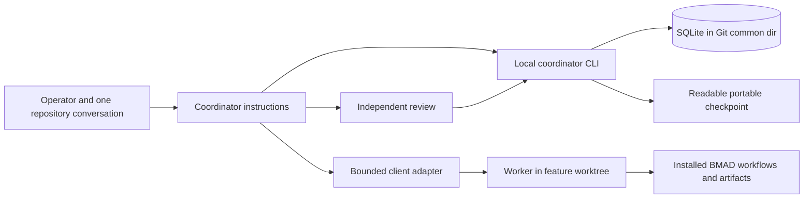

# Coordinator v1: proposed architecture for review

**Status:** technical proposal, 2026-10-04. Operator requirements are recorded in the draft product brief and addendum; the operator accepted the direction of the six-scenario pilot. This design is a technical proposal within the mandate, neither an implemented product nor an approved detailed specification. The [behavior contract](behavior-contract.md) and frozen [assignment protocol](assignment-protocol.md) define behavior. Two native Codex probes support parts of it, not ownership or unattended execution (intent recovery, assignment and acceptance). The [independent design review](v1-review.md) found no remaining design blocker, while preserving implementation and pilot evidence gates.

## Shape and boundaries

Use **opt-in repository instructions plus a small, dependency-light Python standard-library CLI**. The active conversation remains the coordinator: it understands the request, settles decisions within the recorded mandate, issues bounded assignments, assesses evidence, and explains status. The CLI supplies atomic local ownership and state transitions, queries, export, and verification helpers. It is invoked when needed, not an always-on daemon or a second agent. Workers author and correct deliverables; the coordinator writes coordination records. A reviewer is independent of the version reviewed. Relevant nested BMAD reviewers are permitted within the assigned mandate and communicated run budget; there is no arbitrary product descendant cap.

This split addresses distinct failure modes. Instructions and Markdown preserve intent and recovered context, as the first probe showed, but cannot atomically stop two sessions from both claiming a repository. A single canonical JSON snapshot with a stable exclusive lock and atomic replacement **could** update all coordinator records atomically. It would require implementing and testing portable lock ownership, crash recovery, queries, and full-snapshot rewrites. SQLite `BEGIN IMMEDIATE` supplies local transactional locking, schema, and queries through the standard library. It does **not** lock artifact files, stop native workers, or provide cross-clone or multi-host exclusion. The first version requires one computer and a filesystem with reliable SQLite locking; unsupported/shared mounts fail preflight. No WAL requirement is assumed for this small workload (state research).

## Distribution, opt-in, and identity

The starter remains a source of files copied into other repositories. The installable package consists of portable instructions and the CLI; research, fixtures, generated planning outputs, and runtime state stay outside the distribution copy set. Installation is explicit and non-destructive: inspect existing `AGENTS.md` and client instruction files, show the proposed addition, and avoid overwriting local rules. Installed instructions route ordinary substantial requests through discovery; bounded worker briefs explicitly suppress top-level coordinator reactivation. Client-specific instruction loading and execution are tested separately, not inferred from a common file name.

Resolve `git rev-parse --path-format=absolute --git-common-dir`, canonicalize the path, and place the SQLite database there. Linked worktrees share this identity and therefore contend on the same owner generation. Distinct clones do not; the tool must say so. A new feature gets an immutable coordinator ID independent of branch name, path, and BMAD epic number. Record branch, base commit/ref, worktree path, existing dirty paths, and exact writable scopes before assignments. Creating a worktree from an uncommitted bootstrap is unsafe if it silently omits opt-in instructions or BMAD files: preflight checks that the intended base actually contains the required installation. If it does not, either use an explicitly prepared isolated snapshot with recorded provenance or stop that path; never copy the dirty user tree or pretend the worktree contains it. The coordinator may create the authorized feature branch/worktree, but does not implicitly commit, push, deploy, delete data, or merge a target branch.

SQLite is the canonical **local** source for the coordinator's mandate, exclusions, delegated decisions and reasons, owner epoch, assignments, review links, acceptance, and operation history. Existing BMAD artifacts remain authoritative for **their content**; the coordinator records references and hashes, not a rival PRD or sprint engine. A versioned JSON recovery checkpoint and readable Markdown export are derived from **one DB revision** and may be versioned in Git, never silently committed. The JSON includes mandate/decision records, assignment and review status, and source/artifact digests; local owner tokens and reusable process handles stay out. Publish both files together in an immutable revision-and-digest directory using a same-filesystem temporary directory, validation/readback, and atomic directory rename; never overwrite a published version or maintain a mutable filesystem `LATEST` pointer. The canonical current export pointer and pending flag live only in SQLite and change after an owner-and-revision fence. A stale exporter may leave an orphan immutable directory but cannot replace a newer pair or clear pending. Every domain state change marks export pending; a crash before verified publication and pointer update leaves that revision pending. Reject stale, torn, or digest-mismatched imports and manual edits; explicit validated import or a new decision transaction updates canonical state. The CLI's default context view is bounded to active mandate, pending decisions, owner/task/evidence summary, and references; detail is queried by ID. Shared project-scope export has one writer. In a fresh clone, import as recovery evidence, recheck files, mark unfinished work `unknown`, and start with no inherited owner or currently accepted artifacts. A checkpoint does not prove old-clone work stopped. Call a handoff portable only when its checkpoint is verified and available at the destination.

## Ownership and failure recovery

Only one active repository conversation owns the repository-wide **epoch** in v1, even when it coordinates several initiatives. Workers own bounded writable assignments, not the epoch. An acquisition transaction records a random session token, client/session identity, incremented generation, heartbeat, and reason. Every coordinator mutation, assignment claim, and acceptance checks token **and generation** in the same short transaction. A second session may inspect status but cannot launch duplicate work or change decisions. A replaced owner receives a conflict and stops making coordinator state changes. Heartbeat expiry is only a suspicion signal; elapsed time never authorizes takeover.

Each assignment is persisted before external launch with stable ID, feature, owner generation, exact writable paths, source digests, brief reference, permission mode, and status `launch-pending`. The adapter then records the process/session/worker ID and event source. A crash between those steps leaves `launch-unknown`: the next session must inspect client status, process evidence, worktree changes, and return artifacts before retry. Retrying by assignment ID first returns or reconciles the existing record. Unknown does not mean failed. Native child prompts or traces absent from a client export are marked unobserved rather than reconstructed from a coordinator summary.

Normal handoff waits for or stops affected workers, confirms the old **launcher** has relinquished and has no in-flight launch, reconciles pending launches, then changes generation. The precheck-to-external-launch gap matters: an old coordinator could pass a DB check, pause, then launch after takeover. Epoch checks alone cannot fence that launch. After a crash, advance ownership only after verifying the old launcher terminated or relinquished; otherwise keep affected writes blocked or use tested isolation before new work. A stale owner returning is fenced from **database transitions**, not arbitrary filesystem access. If an affected worker might still write, block that writable scope and dependent acceptance until quiescence is proven. Unrelated work may advance only in demonstrably disjoint paths without shared dependencies. A fresh worktree helps only when the old worker cannot reach it or shared files. If stop/status and isolation are insufficient, the pilot ownership step is **blocked**, not redefined as a pass.

## Mandate, decisions, and BMAD route

Intake records outcome, exclusions, existing project constraints, completion evidence, decision scope, source revisions, and independent/dependent tasks. It resolves consequential ambiguity while the operator is available. Technical and product choices inside that mandate are made by the coordinator and recorded as **delegated decisions** with rationale and source. They are never labelled operator approval. A conflict with a settled boundary or a decision outside the mandate becomes a batched operator question with options, consequences, a boundary example, and a recommendation; only dependent work pauses. Data deletion requires separate prior authorization. Publication, target-branch integration, deployment, and BMAD package updates likewise require their own mandate. Work under an unrelated feature does not inherit this feature's authority.

At opt-in and after any consented BMAD update, inspect the installed manifest/catalog, selected skill files and referenced contracts, overrides, resolved configuration, and artifact format. Record a fingerprint of the **exact dependency bundle and relevant contract files**, not just a reported version. Bind each assignment to an installed contract and source fingerprint; if they change, mark affected work for compatibility review rather than assuming an online guide matches the installation. The inspected snapshot supports feature-scoped headless PRD and architecture paths, including architecture review gates. Their default output naming needs an explicit feature workspace (BMAD integration research). The coordinator routes the feature PRD before dependent architecture, passes project-wide constraints, and never silently rewrites a project spine from a feature assignment.

An interactive BMAD step can require an answer without requiring the **operator** to answer. The worker returns a structured `NEEDS_DECISION` with the contract gate, question, options, affected work, and whether it falls within the mandate. The coordinator records and supplies an in-mandate delegated decision, then resumes the workflow through its supported interaction. It escalates only a real authority gap. It cannot skip a Continue gate, invent a headless mode, or claim that a client supports this loop if it cannot route, pause, and resume the exchange. The installed epic/story workflow is interactive; any use of it is conditional on that interaction being demonstrated. The first planning path need not generate epics or sprint status. If later needed, shared tracking has one writer, complete input inventory, and repository-wide integer IDs; per-feature status is used only when the installed generator and Loop path prove compatible. Feature IDs never substitute for BMAD's numeric epic keys.

Global project PRD, architecture, decision files, shared tracking, and any common ledger have a single serialized writer. A feature worktree is not permission to edit a shared file independently. Changes to a shared contract require a project-level mandate, dependency review, and fresh evidence for affected features. Later Loop integration hands a reviewed reachable spec and implementation ownership to the installed Loop orchestrator; the coordinator does not become a second dev/review scheduler or mutate Loop-owned run state. These are later compatibility gates, not first-pilot promises.

## Client adapter and execution envelope

The first **worker adapter to implement** is Codex CLI `codex exec` in an explicit feature worktree, invoked by the opted-in Codex conversation that owns decisions. The research also found native Codex delegation and the two probes observed it; that path remains experimental. Choosing the process adapter first is deliberate: launch process, cwd, event output, exit, and saved session IDs give the ownership pilot more inspectable lifecycle evidence than the session-only native tool currently exposes. Local help confirms command surfaces, not successful jobs, event completeness, entitlement, or overnight life (client research). An assignment provides frozen input versions, role, writable paths, exclusions, supported BMAD route, return schema, review needs, and budget. The adapter records client/version, cwd, actual permission mode, launch mode, session ID, event log, timeout/exit, and result. Approval denial or lost return yields blocked/unknown state. A generic CLI process does not expose the native desktop `spawn_agent` tool.

Every client capability record separates *documented*, *locally observed*, and *pilot verified*: instruction load; native role/launch; cwd/worktree; context isolation and inherited instructions; return/event detail; wait/resume; liveness/stop; permission behavior; descendant and budget visibility. Codex desktop/native, Codex CLI, Claude Code, Copilot CLI, and Copilot IDE chat have separate records and acceptance results. A human-carried prompt is an assisted handoff, never unattended delegation. No client receives a support claim merely because another client passed.

This design can keep useful work moving while its host conversation/process is active. Persistence allows a later session to resume; it does **not** wake a session, supervise a lost child, or prove overnight continuation. If the selected host cannot wait and continue reliably, a later **explicitly started bounded foreground CLI driver** must own continuation: run or restart bounded coordinator turns from persisted state, reconcile assignment evidence, and proceed only within the mandate. Ownership transfers to that run; the interactive conversation cannot remain a competing owner, and operator decisions/stop route to the driver or through orderly handoff. Merely launching workers while a desktop conversation waits does not meet this gate. Driver outcomes distinguish `continue`, `needs-human`, `done`, and `failed`; an ambiguous launch is reconciled, never generically retried. It retains event evidence and honors permissions without bypass. Its liveness and recovery require a dedicated test. Prolonged independently driven operation remains outstanding; a session-bound planning milestone cannot complete that broader v1 goal.

## Review, acceptance, and currentness

Worker completion is a claim. Record its return, changed paths, checks, descendants, and digests. Copy the exact artifact/dependency bytes into a **content-addressed read-only bundle under the Git common directory**, with a manifest of paths, SHA-256 digests, mandate revision, and BMAD contract fingerprint. Verify copied bytes and source digests before sealing the bundle; if source changes during capture, retry or mark unknown. An independent reviewer reads that bundle, not a moving worktree. Its finding names the bundle and versions. The coordinator sends edits to the owning worker and re-reviews changed versions and affected dependencies. BMAD `final` or headless `complete` is workflow evidence, not acceptance. `partial`, `blocked`, unknown worker state, and unresolved critical findings remain visible.

An acceptance transaction checks ownership generation and records the reviewed bundle and dependency set. SQLite cannot atomically snapshot external files: immediately before acceptance, compare working files to the bundle; recheck when showing a result as **currently accepted**. A mutation may follow either read, so acceptance is historical and current-file status is a point-in-time verification. A changed PRD invalidates architecture review based on its older digest. A stale handoff hash with an otherwise reviewed current artifact calls for metadata repair, not redundant review. Handoff uses a quiescent scoped workspace and final comparison; change makes currentness unknown. The pilot must exercise a later mutation.

## First path and proof boundary

An ordinary opted-in feature request enters discovery and capability preflight, records a mandate and owner epoch, creates an authorized feature worktree, assigns PRD and then dependent architecture work, obtains independent version-bound review and worker-owned correction, and exports a durable handoff. A fresh session reconciles owner/worker state and current artifacts before doing anything twice. The [delivery outline](v1-delivery-outline.md) stages this into testable slices. The first supported topology is **one local clone and its linked worktrees**; common-dir ownership does not detect a competing coordinator in a separate clone on the same computer. No support claim is made until **all six** accepted pilot scenarios run for the named client with retained evidence. If worker quiescence cannot be shown in the second-coordinator scenario, the result is blocked even if DB fencing works. The pilot ends at reviewed planning; implementation delivery, Loop, concurrent execution, and true overnight continuation need later gates.
